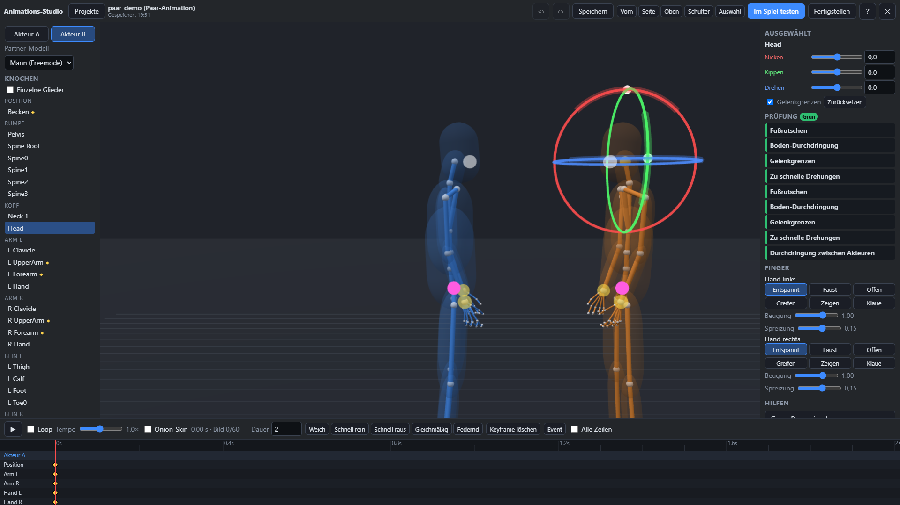
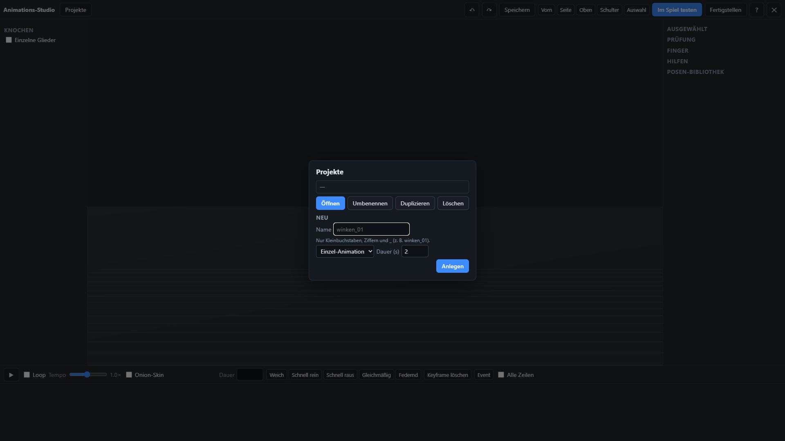
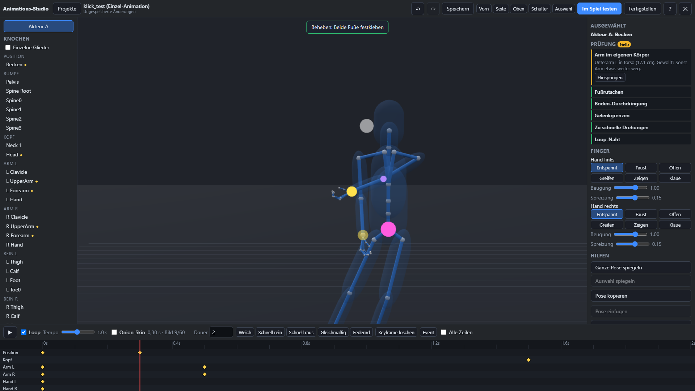
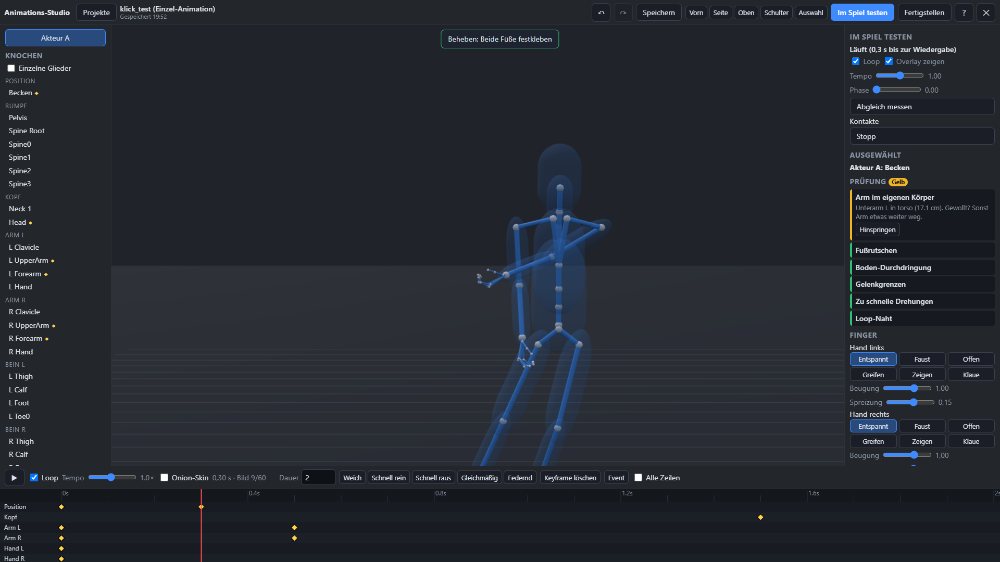
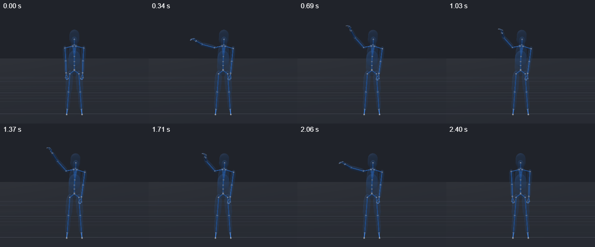
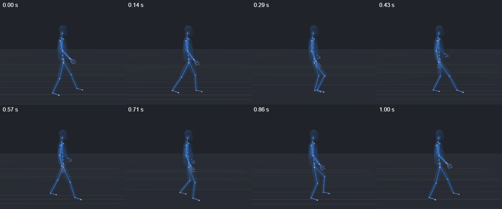
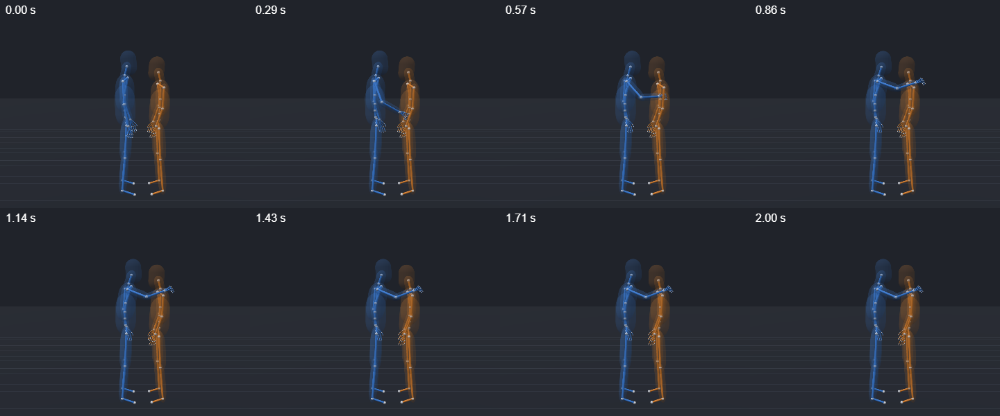

# Bedienung

Die Bilder stammen aus dem automatischen Browser-Test (`tests/nui.mjs`). Im Spiel siehst du statt des dunklen Hintergrunds die echte Spielszene mit deinem halbtransparenten Ped.

## Überblick

| Bereich | Was du dort machst |
|---|---|
| **Oben** | Projekte, Rückgängig/Wiederholen, Speichern, feste Kamera-Ansichten, **Im Spiel testen**, **Fertigstellen**, Hilfe (Tutorial), Schließen |
| **Links** | Akteur wählen (A, bei Paaren auch B), Partner-Modell, Knochenbaum (Knochen anklicken = auswählen). Gelb markierte Knochen haben Keyframes. „Einzelne Glieder“ zeigt jedes Fingerglied |
| **Mitte** | 3D-Ansicht: Skelett mit Körperform genau über dem Ped, Drehringe, Griffe |
| **Rechts** | Ausgewählt (Werte, Gelenkgrenzen), Prüfung (Ampel), Finger, Hilfen, Posen-Bibliothek. Während eines Tests steht ganz oben „Im Spiel testen“ |
| **Unten** | Wiedergabe, Loop, Tempo, Onion-Skin, Dauer, Kurvenarten, Keyframe löschen, Event, Zeitleiste |

Jeder Knopf hat einen Tooltip mit einem Satz Erklärung (Maus kurz darauf halten).

## Projekte

- **Neu:** Name (nur `a-z`, `0-9`, `_`), Einzel- oder Paar-Animation, bei Paar das Partner-Modell, Dauer. Neue Projekte starten in einer natürlichen Standpose.
- **Öffnen**, **Umbenennen**, **Duplizieren**, **Löschen** (mit Rückfrage; eine Sicherung bleibt auf dem Server).
- **Speichern:** automatisch alle 30 s, sofort mit Strg+S. Der Server hebt die letzten 10 Versionen auf.

## Kamera

| Aktion | Maus / Taste |
|---|---|
| Drehen | linke Maustaste auf freiem Platz ziehen |
| Zoomen | Mausrad |
| Verschieben | rechte Maustaste ziehen |
| Feste Ansichten | Vorn (1), Seite (2), Oben (3), Schulter (4), Auswahl (F) |

Die Spielkamera folgt dem Studio. Spielbild und Skelett bewegen sich immer gemeinsam.

## Posen einstellen

- **Drehringe:** Klick auf ein Gelenk (weiße Kugel) oder auf einen Knochen im Baum. Drei farbige Ringe erscheinen (rot, grün, blau = die drei Achsen des Gelenks). Am Ring ziehen dreht das Körperteil. Die hellen Bögen zeigen den erlaubten Bereich. **Gelenkgrenzen** (Taste L) begrenzen auf natürliche Winkel, standardmäßig an. Rechts kannst du die Werte auch als Zahl eingeben.
- **Griffe (IK):**
  - **Gelb = Hände, türkis = Füße:** Ziehen bewegt die ganze Kette natürlich.
  - **Pink = Becken:** Ziehen verschiebt den Körper über den Beinen.
  - **Weiß vor dem Kopf = Blickziel.**
  - **Lila = Ellbogen- bzw. Knierichtung:** erscheint, sobald ein Arm oder Bein per Griff gesteuert wird.
  - **Grüner Ring am Boden = Standpunkt:** Ziehen verschiebt, Shift + Ziehen dreht.
  - **Ändern beim Ziehen:** Alt + Ziehen bewegt nur in der Höhe, Shift + Ziehen nur waagerecht.
- **IK wieder lösen:** Wird ein Arm per Griff gesteuert, sind seine Ringe aus. „IK entfernen“ gibt ihn wieder frei.
- **Finger:** pro Hand eine Vorlage (Entspannt, Faust, Offen, Greifen, Zeigen, Klaue), dazu Regler für Beugung und Spreizung. Einzelne Glieder: „Einzelne Glieder“ anhaken und im Baum drehen.
- **Hilfen:**
  - Ganze Pose spiegeln (M) oder nur den gewählten Knochen spiegeln.
  - Pose kopieren/einfügen (Strg+C / Strg+V).
  - „Auf den Boden“ setzt den gewählten Fuß (oder beide) genau auf den Boden.
  - „Füße festkleben“: erst einen Bereich in der Zeitleiste wählen (Alt + Ziehen auf dem Lineal).
  - Bei Paaren „Hand festkleben an …“: Hand- oder Fuß-Griff wählen, dann das Körperteil des Partners. Der Kontakt hält, auch wenn du weiter bearbeitest.
- **Posen-Bibliothek:** Grundposen Stand, Hocke, Kampfstellung, Greifen. „Pose speichern“ legt deine eigene Pose auf dem Server ab.

## Zeitleiste und Keyframes

- **Keyframes:** Jede Änderung setzt automatisch einen Keyframe zur aktuellen Zeit (Raute in der Zeile des Körperteils).
- **Zeit wählen:** auf das Lineal klicken.
- **Rauten:** anklicken = auswählen, Shift + Klick = mehrere, ziehen = verschieben, Entf = löschen, Strg+C / Strg+V = kopieren und an der aktuellen Zeit einfügen.
- **Kurvenart** der gewählten Rauten:
  - weich: langsam los, langsam an
  - schnell rein: startet schnell und bremst ab
  - schnell raus: startet langsam und kommt schnell an
  - gleichmäßig
  - federnd: schwingt über und federt zurück
- **Wiedergabe:** Leertaste, Tempo 0,1–2×, Onion-Skin (O) zeigt vorige und nächste Pose als Schatten. ← / → gehen ein Bild weiter, Shift + ← / → springen zum nächsten Keyframe.
- **Loop:** Ende = Anfang, die Naht wird sauber geschlossen.
- **Event:** Marker mit Name und optionaler Dauer, z. B. `impact`. Im Bericht steht er mit Zeitpunkt und Phase.
- **Dauer** ändern: Feld „Dauer“ (Keys hinter dem Ende rücken ans Ende).

## Ampel-Prüfung

Rechts unter „Prüfung“ läuft die Prüfung live mit, kurz nach jeder Änderung:
- Fußrutschen
- Boden-Durchdringung
- Gelenkgrenzen
- zu schnelle Drehungen
- Durchdringung zwischen Akteuren
- offene Kontakte
- Loop-Naht
- Startversatz (Einzel)

Jede Meldung steht in Klartext. **Hinspringen** setzt die Zeit an die Stelle, **Beheben** repariert, wo es geht: Füße festkleben, Becken anheben, Winkel begrenzen, Kurven weich machen, Partner wegschieben, Kontakt festkleben, Naht schließen.

## Im Spiel testen

1. **Starten:** „Im Spiel testen“ drücken. Beim ersten Mal kommt ein Hinweis: Die Stream-Resource wird neu gestartet, alle Spieler laden die neue Animation kurz nach.
2. **Umwandeln:** Der Server wandelt um, startet die Stream-Resource neu, und dein **echter** Ped spielt die echte `.ycd` (bei Paaren beide Peds). Die Zeit vom Knopfdruck bis zur Wiedergabe wird angezeigt.
3. **Steuerung:** Loop, Tempo und Phase. Dazu kommt das Mess-Overlay: Abstand der Kontaktpunkte in cm, gemessen an den echten Knochen, rot über 3 cm.
4. **Abgleich messen:** vergleicht das Overlay-Skelett mit den echten Knochen (Ziel ≤ 1 cm).
5. **Stopp:** zurück zum Bearbeiten.

## Fertigstellen

„Fertigstellen“: Name, Ziel-Resource und Dict-Name eintragen, dann „Umwandeln“. Es entstehen:
- die endgültige `.ycd`: `jj_animstudio/data/outbox/final/<dict>.ycd`, außerdem in `jj_animstudio_stream` zum Weiterspielen
- der Bericht für Claude mit Registry-Eintrag und fertigem Lua-Snippet (Einzel-Clip mit `TaskPlayAnim` bzw. Paar-Szene mit zwei vernetzten Szenen): `data/outbox/<name>.report.md` und `.json`

Der Bericht erscheint auch im Fenster, „Kopieren“ legt ihn in die Zwischenablage.

## Tastenkürzel

| Taste | Wirkung |
|---|---|
| Leertaste | Abspielen / Pause |
| Strg+Z / Strg+Y | Rückgängig / Wiederholen (mindestens 100 Schritte) |
| Strg+S | Speichern |
| Strg+C / Strg+V | Pose (oder gewählte Keyframes) kopieren / einfügen |
| Entf | gewählte Keyframes, Event, Kontakt oder Fuß-Bereich löschen |
| M | ganze Pose spiegeln |
| O | Onion-Skin an/aus |
| L | Gelenkgrenzen an/aus |
| F | Kamera auf die Auswahl |
| 1 / 2 / 3 / 4 | Vorn / Seite / Oben / Schulter |
| ← / → (mit Shift) | ein Bild (zum nächsten Keyframe) |
| ESC | Dialog schließen bzw. Studio schließen (mit Rückfrage) |

## Deine erste Animation in 5 Minuten (Winken)

1. **Anlegen:** `/animstudio`, im Projektfenster Name `winken_01` eintragen, „Einzel-Animation“, Dauer 2, „Anlegen“.
2. **Pose bei 0,5 s:** Taste 1 (Kamera vorn). Auf dem Lineal bei 0,5 s klicken. Im Knochenbaum `R UpperArm` wählen und am blauen oder grünen Ring ziehen, bis der Arm seitlich nach oben zeigt. `R Forearm` wählen und am roten Ring beugen. Rechts bei „Hand rechts“ „Offen“ drücken.
3. **Winkbewegung:** bei 0,8 s den Unterarm etwas zurück drehen, bei 1,1 s wieder beugen. Die Zeitleiste zeigt die Rauten.
4. **Ansehen:** Loop anhaken, Leertaste. Wirkt es abgehackt, alle Rauten von Arm R wählen und „weich“ drücken. Die Ampel muss grün oder gelb sein. Steht etwas auf Rot: „Beheben“.
5. **Testen und fertigstellen:** „Im Spiel testen“ → dein Ped winkt. Passt es, „Fertigstellen“ mit Dict `jj_winken`, dann den Bericht kopieren und an Claude schicken.

## Kontaktbögen der Beispiele

Die Beispiele in `animkit/examples/` lassen sich als Bildreihe ansehen: `node jj_animstudio/tools/contact-sheets.mjs`.

